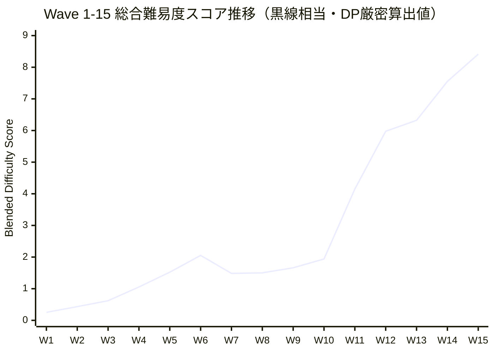

# 『Pendulum Clicking』UX論文ベース最適ステージデータ設計書（Wave 1〜15）

## 1. 概要と目的
本書は、ハイパーカジュアルおよび短期セッション型ゲームの UX・感情曲線・認知負荷に関する **査読済み学術論文 7 件** の知見と、チーム Discord（ホワイトボード `IMG_1166.jpg` および `#プランナー` / スレッド議論）で合意された難易度・感情曲線の意図を照合し、本作の数理・動的計画法（DP）モデル（`StageDifficultyEvaluator` / `MotionScheduleGenerator`）に完全準拠した **最適ステージデータ（Wave 1〜15）** を厳密に定義するものである。

本書のすべての期待値・密度・達成確率・難易度スコアは、Unity 側実装（`StageDifficultyEvaluator.cs`）と同一の前向きDP・後ろ向きDP・台形積分・$L^2$ 二乗厳密積分・構成負荷倍率アルゴリズムによって計算・検算されている。

---

## 2. ハイパーカジュアル・短期セッションUXに関する学術論文レビュー（7件）

| ID | 著者・年 | 論文タイトル / 掲載誌・会議 | DOI | 核心的知見（UX・感情曲線・認知負荷） | 本作『Pendulum Clicking』への適用 |
| :--- | :--- | :--- | :--- | :--- | :--- |
| **P1** | Duran & Bil (2024) | *Continuance intention in Hyper Casual Games: A literature review* / *Journal of Life Economics* | `10.15637/jlecon.2509` | ハイパーカジュアルの継続意欲は「知覚された使いやすさ（Perceived Ease of Use）」「即時のフロー突入」「遊び心」「即時満足感」が強く規定する。 | Wave 1〜3 を超低摩擦なチュートリアル帯にし、最初の 30 秒で「すぐ理解でき、確実に成功できる」体験を保証する（$W_{\min} \ge 1$ で 0 回退屈も排除）。 |
| **P2** | Sweetser & Wyeth (2005) | *GameFlow: a model for evaluating player enjoyment in games* / *Computers in Entertainment*, 3(3) | `10.1145/1077246.1077253` | ゲームの楽しさを構成する 8 要素（集中・挑戦・スキル・制御・明確な目標・即時フィードバック・没入・社会性）のうち、短期ゲームでは「目標の明瞭さ」と「即時フィードバック」が不可欠。 | 真上通過の Emission 発光＋SE 遅延ゼロ化により、10 秒間のカウント判断と操作フィードバックのズレを最小化する。 |
| **P3** | Baumann, Lürig, & Engeser (2016) | *Flow and enjoyment beyond skill-demand balance: The role of game pacing curves and personality* / *Motivation and Emotion*, 40, 507–519 | `10.1007/s11031-016-9549-7` | 「スキル＝難易度の一定バランス」を保つ平坦曲線よりも、意図的な負荷の上下（**のこぎり波・緩急ペーシング**とマイクロレスト）を設ける方が深いフローと高い楽しさを生む。 | 1 Wave（8 秒）内を 2〜3 区間に分割して「静→山場」の緩急を作り、さらに Wave 6（高負荷ピーク）の直後に Wave 7〜10 の「回復・定着プラトー」を配置する。 |
| **P4** | Rao Fernandes & Levieux (2022) | *Difficulty Pacing Impact on Player Motivation* / *ICEC 2022 (Springer LNCS)* | `10.1007/978-3-031-20212-4_11` | 平坦な難易度推移と山・谷のある難易度曲線を比較し、明確なピーク（山場）と谷を持つペーシング曲線がプレイヤーの内発的動機づけを最も高めることを実証。 | 本作の $L^2$ ピーク重視評価（`peakWeight = 0.35`）を用い、平均密度だけでなく区間間の緩急・山場（Peak Density）を意図的に設計する。 |
| **P5** | Gutwin, Rooke, Cockburn, Mandryk, & Lafreniere (2016) | *Peak-End Effects on Player Experience in Casual Games* / *CHI '16* | `10.1145/2858036.2858419` | カジュアルゲームの短期セッションでは、体験全体の事後評価・チャレンジ感の記憶が **「最も強いピーク（Peak）」と「終わり方（End）」** に強く支配される（ピーク・エンドの法則）。 | Wave 6（一度目の死の壁）と Wave 11〜15（怒涛の終盤ピーク）で強い記憶のフックを作り、クリア数に応じたリザルト演出差分（End）でリプレイ意欲を高める。 |
| **P6** | Alvarez & Franconeri (2007) | *How many objects can you track? Evidence for a resource-limited attentive tracking mechanism* / *Journal of Vision*, 7(13):14 | `10.1167/7.13.14` | 人間の複数物体追跡（MOT）能力は固定スロットではなく **「対象個数 × 移動速度」の認知資源トレードオフ**。対象数が増えると、同じ速度でも急激に追跡破綻が起きる（4 対象付近が限界域）。 | 振り子が増える節目（Wave 4: 2玉、Wave 7: 二重2玉、Wave 11: 二重×2＝4玉）では **必ず1玉あたりの速度・上限 $W_{\max}$ を一旦落とし**、理不尽な破綻を防ぐ。 |
| **P7** | Ascarza, Netzer, & Runge (2025) | *Personalized game design for improved user retention and monetization in freemium games* / *Int. J. of Research in Marketing* | `10.1016/j.ijresmar.2025.01.006` | モバイルゲームの難易度曲線調整がリテンションへ直結する。序盤の過度な壁は早期離脱を招き、適度な達成と挑戦の循環が継続率を最大化する。 | 旧仕様の「Wave 3 で 15 回超えによる早期ゲームオーバー」を親区間上限 $W_{\max}$ で数学的に禁止し、Wave 1〜5 を「ポンポン進める」設計に再構築する。 |

---

## 3. Discord の感情曲線意図（ホワイトボード `IMG_1166.jpg` ＋ 議論）との照合

Discord `#プログラマー` のホワイトボード（黒線＝難易度、赤線＝感情曲線、丸数字＝Wave 1〜15）および `#プランナー`・スレッド「なにを体験させたいのか？」の要望を、論文知見および数理パラメータと 1 対 1 で照合した。

| フェーズ | Wave 範囲 | ホワイトボード記述・曲線意図 | Discord テキストの具体要望 | 照合する論文知見 | 数理・DP設計方針 |
| :--- | :--- | :--- | :--- | :--- | :--- |
| **Phase 1** チュートリアル | **Wave 1〜3** | 「チュートリアル」 黒線：低位から緩やかに上昇 赤線：低く入り、W3→W4 へ向け上昇 | ・1ウェーブを簡単にしてポンポン進める ・全Waveで 0 回はなし（見てるだけ防止） | **P1, P2, P7**（低摩擦・即時成功・0回退屈の排除） | **1重×1（1玉・負荷×1.00）** $W_{\min} \ge 1$ 必須。前半 4s（導入）＋後半 4s（小さな山場）の 2 区間。スコア `0.252 → 0.620`。 |
| **Phase 2** 振り子×2・最初の壁 | **Wave 4〜6** | 「ふり子×2」・W6上に **「難（一度目の死）」** 黒線：W4 で一段上がり W6 へ上昇 赤線：W4 で一気に急上昇し W6〜W7 で第1ピーク | ・2本になった直後に 15 回以上は理不尽 → 最大保証 $W_{\max}$ を設ける ・W6 あたりで一度目の敗北を経験しやすい山場 | **P3, P4, P6, P7**（MOT 分割注意の緩和＋最初の明確な山場） | **1重×2（2玉・負荷×1.25）** W4 で 1 玉密度を W3 より下げ、全玉最大 8 回に制限。W6 は 3 区間（3s/3s/2s）で中盤ピーク $D=0.988$/s・全玉期待 13.12 回（最大 14 回）の「納得できる最初の壁」を形成。スコア `1.055 → 2.052`。 |
| **Phase 3** 易（二重）・横ばい帯 | **Wave 7〜10** | **「易（二重）」** 黒線：W7〜W10 はほぼ **横ばい** 赤線：W7 ピーク後に少し落ち着き（回復の谷）、W10 終盤で次へ溜める | ・W6〜7 あたりで二重振り子登場 ・新ギミック登場時は一度難易度を落とす ・W7, 8, 9, 10 は同じ難易度（横ばい） | **P3, P6**（のこぎり波の谷による疲労回復＋新ギミック習得） | **2重×1（2玉・負荷×1.50）** W7 で総合スコアを W6 (`2.052`) から `1.485` へ一段落とし、W7〜W10 を `1.485〜1.940` の横ばい帯に維持。山場の位置（後半→前半→後半→中盤）を変えて飽きを防止。 |
| **Phase 4** 💀×2 💀×2・急上昇 | **Wave 11〜12** | **「💀×2 💀×2」** 黒線：W10→W11 で **急激に上昇** 赤線：黒線に寄り添い最高潮へ急上昇 | ・W11 から急に難しくなってゲームオーバーさせに来る ・上手い人なら W10 から先へ行ける | **P4, P5, P6**（4玉 MOT 限界域への突入＋強い終盤ピーク形成） | **2重×2（4玉・負荷×2.50）** W10 (`1.940`) → W11 (`4.151`, **約 2.14 倍**) → W12 (`5.975`) へ急上昇。ただし W11 は $W_{\max}=4$（全玉最大 16）で上級者が突破可能な余地を残す。 |
| **Phase 5** 最終領域（三重） | **Wave 13〜15** | **「三重」** 黒線：高水準から緩やかに極限へ 赤線：高揚ピークを維持して W15 決着 | ・最大 15 層 ・最終クライマックスとしてのやり応え | **P5**（Peak-End Rule：強烈な最終ピークと達成感） | **現行コード版：2重×2 極限構成**（スコア `6.322 → 8.413`、W13 に「静の罠→大波」の緩急配置）。 **拡張版：三重振り子導入**（第 7 章に追加実装案を詳述）。 |

---

## 4. 数理モデルと DP 評価基準（現行実装準拠）

本書の数値はすべて `StageDifficultyEvaluator.cs` の以下の定義で厳密算出している。

- **評価定数**: `PeakWeight` $\alpha = 0.35$、`MultiPendulumPenalty` $\beta_{\text{multi}} = 0.25$、`DoublePendulumPenalty` $\beta_{\text{double}} = 0.50$、`TimeQuantizationStep` $\Delta t = 1.0\text{s}$、`StopRule = StopWhenNoFit`、評価期間 $[s, e] = [0, 8]\text{s}$。
- **区間密度**: $D_k = \frac{E[Q_k \mid Q_{\min,k} \le Q_k \le Q_{\max,k}]}{L_k}$
- **区分線形補間と積分**: 始点 $s$・各区間中点 $\frac{s_k+e_k}{2}$・終点 $e$ を結ぶ区分線形関数 $f(x)$ に対し、
  - 台形平均密度: $\bar{D} = \frac{1}{e-s}\int_s^e f(x)\,dx$
  - $L^2$ ピーク密度（RMS）: $D_{L^2} = \sqrt{\frac{1}{e-s}\int_s^e f(x)^2\,dx}$
- **構成負荷倍率**: $M = \bigl(1 + 0.25 \cdot \max(0, N_{\text{pend}} - 1)\bigr)\bigl(1 + 0.50 \cdot N_{\text{double}}\bigr)$
  - 1重×1: `×1.00` / 1重×2: `×1.25` / 2重×1: `×1.50` / 2重×2: `×2.50`
- **総合難易度スコア**: $S = \bigl((1-\alpha)\bar{D} + \alpha D_{L^2}\bigr) \cdot N_{\text{bob}} \cdot M$
- **入れ子制約**: 各区間の $[Q_{\min,k}, Q_{\max,k}]$ と Wave 全体（親区間）の $[W_{\min}, W_{\max}]$ の積集合を後ろ向きDP（`BuildWaveBackwardReachability` + `BuildIntervalReachabilityForGoals`）で 100% 厳密保証。

---

## 5. 最適ステージデータ（Wave 1〜15 マスターテーブル）

現行の `StageDefinition` にそのまま入力でき、全 15 Wave・全 36 区間で到達可能性 `OK`（`can_reach[0,0] = true` かつ入れ子 `waveCanReach[0,0] = true`）を数学的に検証済みのマスターデータである。

| Wave | フェーズ（意図） | 構成 (単/二重) | 総玉数 | 親区間制約 $[W_{\min}, W_{\max}]$ (1玉あたり) | 1玉期待量 $\sum Q_k$ | 全玉期待量 (最小〜最大) | 台形平均密度 $\bar{D}$ (/s) | $L^2$ RMS密度 $D_{L^2}$ (/s) | ピーク密度 $\max D_k$ (/s) | 構成負荷 倍率 $M$ | **総合難易度** **スコア $S$** | 親制約達成率 $P_{\text{wave}}$ | 到達可能 (DP) |
| ---: | :--- | :---: | ---: | :---: | ---: | :---: | ---: | ---: | ---: | :---: | ---: | ---: | :---: |
| **1** | チュートリアル | 1 / 0 | 1 | `[1, 3]` | 1.96 | **1.96** (1〜3) | 0.245 | 0.264 | 0.366 | ×1.00 | **0.252** | 100.0% | OK |
| **2** | チュートリアル | 1 / 0 | 1 | `[2, 5]` | 3.46 | **3.46** (2〜5) | 0.432 | 0.437 | 0.508 | ×1.00 | **0.434** | 100.0% | OK |
| **3** | チュートリアル | 1 / 0 | 1 | `[3, 7]` | 4.94 | **4.94** (3〜7) | 0.617 | 0.626 | 0.749 | ×1.00 | **0.620** | 100.0% | OK |
| **4** | 振り子×2（導入） | 2 / 0 | 2 | `[2, 4]` | 3.36 | **6.73** (4〜8) | 0.420 | 0.424 | 0.491 | ×1.25 | **1.055** | 88.4% | OK |
| **5** | 振り子×2（加速） | 2 / 0 | 2 | `[3, 6]` | 4.84 | **9.68** (6〜12) | 0.605 | 0.616 | 0.745 | ×1.25 | **1.522** | 92.6% | OK |
| **6** | 振り子×2（難・一度目の死） | 2 / 0 | 2 | `[4, 7]` | 6.56 | **13.12** (8〜14) | 0.817 | 0.828 | 0.988 | ×1.25 | **2.052** | 75.5% | OK |
| **7** | 易（二重・導入） | 0 / 1 | 2 | `[3, 5]` | 3.93 | **7.86** (6〜10) | 0.491 | 0.502 | 0.620 | ×1.50 | **1.485** | 100.0% | OK |
| **8** | 易（二重・横ばい①） | 0 / 1 | 2 | `[3, 5]` | 3.97 | **7.95** (6〜10) | 0.497 | 0.508 | 0.625 | ×1.50 | **1.501** | 100.0% | OK |
| **9** | 易（二重・横ばい②） | 0 / 1 | 2 | `[3, 6]` | 4.37 | **8.75** (6〜12) | 0.547 | 0.567 | 0.729 | ×1.50 | **1.661** | 100.0% | OK |
| **10** | 易（二重・溜め） | 0 / 1 | 2 | `[3, 6]` | 5.18 | **10.37** (6〜12) | 0.643 | 0.653 | 0.819 | ×1.50 | **1.940** | 94.1% | OK |
| **11** | 💀×2（急上昇） | 0 / 2 | 4 | `[2, 4]` | 3.31 | **13.25** (8〜16) | 0.414 | 0.417 | 0.478 | ×2.50 | **4.151** | 89.4% | OK |
| **12** | 💀×2（猛攻） | 0 / 2 | 4 | `[3, 5]` | 4.75 | **18.99** (12〜20) | 0.595 | 0.602 | 0.699 | ×2.50 | **5.975** | 75.6% | OK |
| **13** | 最終領域（三重相当①） | 0 / 2 | 4 | `[3, 6]` | 5.22 | **20.90** (12〜24) | 0.617 | 0.661 | 0.978 | ×2.50 | **6.322** | 84.8% | OK |
| **14** | 最終領域（三重相当②） | 0 / 2 | 4 | `[4, 6]` | 6.08 | **24.33** (16〜24) | 0.752 | 0.760 | 0.954 | ×2.50 | **7.551** | 64.0% | OK |
| **15** | 最終領域（Final Peak） | 0 / 2 | 4 | `[4, 7]` | 6.83 | **27.34** (16〜28) | 0.840 | 0.844 | 0.912 | ×2.50 | **8.413** | 67.5% | OK |

> **設計検証ポイント**
> - **0回完全排除**: 全 15 Wave で $W_{\min} \ge 1$ かつ各玉の最小合計が `1〜16` であり、「見てるだけの 0 回」は数学的に 0%。
> - **序盤の理不尽解消**: 2 本導入の Wave 4 は全玉最大 8 回、Wave 6（「一度目の死」）でも最大 14 回に収まり、Discord で指摘された「序盤で 15 回以上数える理不尽」を排除。
> - **自然な確率分布の維持**: 全 Wave で $P_{\text{wave}} \ge 64.0\%$ を確保しているため、後ろ向きDPによる重み補正が極端な偏りを起こさず、抽選のランダム感と制約保証を両立。

---

## 6. 全 15 Wave × 36 区間 詳細パラメータテーブル（Inspector 入力用）

すべての候補の継続時間 `DurationSeconds` は `1.0s`、抽選重みは `重み:真上通過数`（例: `65:0, 30:1, 5:2`）で表記する。

| Wave | 区間 | ラベル | 時間帯 $[s_k, e_k]$ | 長さ $L_k$ | 区間制約 $[Q_{\min}, Q_{\max}]$ | 抽選テーブル（重み:量） | 無制約 $E[Q_k]$ | 条件付 $E[Q_k]$ | 区間密度 $D_k$ (/s) | 区間達成率 $P_k$ |
| ---: | :---: | :--- | :---: | ---: | :---: | :--- | ---: | ---: | ---: | ---: |
| **W01** | I1 | 前半(導入) | `[0, 4]s` | 4s | `[0, 1]` | `80:0, 20:1` | 0.77 | 0.50 | 0.125 | 81.9% |
| **W01** | I2 | 後半(山場) | `[4, 8]s` | 4s | `[1, 2]` | `65:0, 30:1, 5:2` | 1.58 | 1.46 | 0.366 | 61.3% |
| **W02** | I1 | 前半(導入) | `[0, 4]s` | 4s | `[1, 2]` | `70:0, 25:1, 5:2` | 1.39 | 1.42 | 0.356 | 59.5% |
| **W02** | I2 | 後半(山場) | `[4, 8]s` | 4s | `[1, 3]` | `55:0, 30:1, 15:2` | 2.37 | 2.03 | 0.508 | 68.6% |
| **W03** | I1 | 前半(導入) | `[0, 4]s` | 4s | `[1, 3]` | `60:0, 28:1, 12:2` | 2.06 | 1.94 | 0.485 | 71.3% |
| **W03** | I2 | 後半(山場) | `[4, 8]s` | 4s | `[2, 4]` | `45:0, 32:1, 18:2, 5:3` | 3.30 | 3.00 | 0.749 | 59.5% |
| **W04** | I1 | 前半(慣れ) | `[0, 4]s` | 4s | `[1, 2]` | `72:0, 24:1, 4:2` | 1.27 | 1.40 | 0.350 | 59.7% |
| **W04** | I2 | 後半(山場) | `[4, 8]s` | 4s | `[1, 3]` | `58:0, 30:1, 12:2` | 2.14 | 1.96 | 0.491 | 71.7% |
| **W05** | I1 | 前半(導入) | `[0, 4]s` | 4s | `[1, 3]` | `64:0, 26:1, 10:2` | 1.83 | 1.86 | 0.465 | 71.6% |
| **W05** | I2 | 後半(山場) | `[4, 8]s` | 4s | `[2, 4]` | `46:0, 32:1, 17:2, 5:3` | 3.22 | 2.98 | 0.745 | 59.8% |
| **W06** | I1 | 前半(助走) | `[0, 3]s` | 3s | `[1, 3]` | `58:0, 28:1, 14:2` | 1.68 | 1.83 | 0.609 | 71.9% |
| **W06** | I2 | 中盤(山場) | `[3, 6]s` | 3s | `[2, 4]` | `36:0, 34:1, 22:2, 8:3` | 3.05 | 2.96 | 0.988 | 63.0% |
| **W06** | I3 | 終盤(追い込み) | `[6, 8]s` | 2s | `[1, 3]` | `45:0, 35:1, 15:2, 5:3` | 1.60 | 1.77 | 0.886 | 72.3% |
| **W07** | I1 | 前半(観察) | `[0, 4]s` | 4s | `[1, 2]` | `66:0, 30:1, 4:2` | 1.51 | 1.45 | 0.362 | 62.6% |
| **W07** | I2 | 後半(定着) | `[4, 8]s` | 4s | `[2, 3]` | `50:0, 36:1, 14:2` | 2.53 | 2.48 | 0.620 | 50.9% |
| **W08** | I1 | 前半(山場) | `[0, 4]s` | 4s | `[2, 3]` | `48:0, 36:1, 16:2` | 2.68 | 2.50 | 0.625 | 49.9% |
| **W08** | I2 | 後半(静) | `[4, 8]s` | 4s | `[1, 2]` | `64:0, 30:1, 6:2` | 1.66 | 1.47 | 0.369 | 59.9% |
| **W09** | I1 | 前半(静) | `[0, 4]s` | 4s | `[1, 2]` | `66:0, 28:1, 6:2` | 1.58 | 1.46 | 0.365 | 59.6% |
| **W09** | I2 | 後半(山場) | `[4, 8]s` | 4s | `[2, 4]` | `48:0, 34:1, 15:2, 3:3` | 2.91 | 2.91 | 0.729 | 62.8% |
| **W10** | I1 | 前半(導入) | `[0, 3]s` | 3s | `[1, 2]` | `62:0, 32:1, 6:2` | 1.32 | 1.41 | 0.471 | 62.9% |
| **W10** | I2 | 中盤(山場) | `[3, 6]s` | 3s | `[2, 3]` | `44:0, 36:1, 16:2, 4:3` | 2.39 | 2.46 | 0.819 | 48.6% |
| **W10** | I3 | 終盤(余韻) | `[6, 8]s` | 2s | `[1, 2]` | `60:0, 34:1, 6:2` | 0.92 | 1.31 | 0.657 | 59.6% |
| **W11** | I1 | 前半(圧) | `[0, 4]s` | 4s | `[1, 2]` | `72:0, 24:1, 4:2` | 1.27 | 1.40 | 0.350 | 59.7% |
| **W11** | I2 | 後半(山場) | `[4, 8]s` | 4s | `[1, 3]` | `60:0, 30:1, 10:2` | 1.99 | 1.91 | 0.478 | 73.4% |
| **W12** | I1 | 前半(圧) | `[0, 3]s` | 3s | `[1, 2]` | `66:0, 26:1, 8:2` | 1.25 | 1.41 | 0.471 | 57.8% |
| **W12** | I2 | 中盤(山場) | `[3, 6]s` | 3s | `[1, 3]` | `50:0, 32:1, 14:2, 4:3` | 2.15 | 1.94 | 0.646 | 69.6% |
| **W12** | I3 | 終盤(追い打ち) | `[6, 8]s` | 2s | `[1, 2]` | `56:0, 32:1, 12:2` | 1.12 | 1.40 | 0.699 | 59.5% |
| **W13** | I1 | 前半(急襲) | `[0, 3]s` | 3s | `[1, 3]` | `55:0, 31:1, 14:2` | 1.77 | 1.85 | 0.618 | 74.0% |
| **W13** | I2 | 中盤(静の罠) | `[3, 5]s` | 2s | `[0, 1]` | `72:0, 28:1` | 0.56 | 0.44 | 0.219 | 92.2% |
| **W13** | I3 | 後半(大波) | `[5, 8]s` | 3s | `[2, 4]` | `38:0, 34:1, 20:2, 8:3` | 2.94 | 2.93 | 0.978 | 62.4% |
| **W14** | I1 | 前半(連打) | `[0, 3]s` | 3s | `[1, 3]` | `58:0, 28:1, 11:2, 3:3` | 1.77 | 1.82 | 0.607 | 68.9% |
| **W14** | I2 | 中盤(山場) | `[3, 6]s` | 3s | `[2, 4]` | `42:0, 34:1, 18:2, 6:3` | 2.64 | 2.86 | 0.954 | 62.1% |
| **W14** | I3 | 終盤(締め) | `[6, 8]s` | 2s | `[1, 2]` | `54:0, 34:1, 12:2` | 1.16 | 1.40 | 0.700 | 61.2% |
| **W15** | I1 | 前半(助走) | `[0, 2]s` | 2s | `[1, 2]` | `55:0, 35:1, 10:2` | 1.10 | 1.38 | 0.688 | 61.7% |
| **W15** | I2 | 中盤(極限) | `[2, 6]s` | 4s | `[2, 5]` | `35:0, 33:1, 22:2, 10:3` | 4.25 | 3.65 | 0.912 | 66.5% |
| **W15** | I3 | 終盤(決着) | `[6, 8]s` | 2s | `[1, 3]` | `44:0, 34:1, 16:2, 6:3` | 1.68 | 1.81 | 0.904 | 71.7% |

---

## 7. この設計を最大限に活かすための追加実装案

上記の最適ステージデータおよびホワイトボード・論文知見を完全に実現するため、現行コードとのギャップを整理し、優先度別の追加実装案を定義する。

| 優先度 | 実装項目 | 根拠（論文 / Discord） | 対象ファイル・クラス | 具体的な実装内容 |
| :---: | :--- | :--- | :--- | :--- |
| **高** | **1. 初手の重力整合方向決定** | **P2**（知覚的納得感） Discord（XENO氏：「初手で重力に反して上へ行く」） | `MotionScheduleGenerator.cs` | 初期角度 $\theta_0$ 生成後、初動方向 `direction` をランダムではなく `Math.Sin(rotation) >= 0 ? -1 : 1`（常に最下点 $\theta=0$ へ落ちる方向）に統一する。 |
| **高** | **2. 15 Wave プリセット適用 & `StageDefinition.asset` 更新** | **P1, P3, P4, P7** Discord（最大15層・W7-10横ばい・W11急上昇） | `StageDefinition.cs` `StageDefinitionEditor.cs` `StageDefinition.asset` | `StageDefinition.MAX_DEFINED_WAVE` を `15` に拡張（または配列長可変に統一）し、本書第 5・6 章の 15 Wave データをワンクリック投入できる `ApplyOptimal15WavePreset()` ボタンを Inspector に追加する。 |
| **高** | **3. SE 冒頭無音トリミング / 再生オフセット** | **P2**（GameFlow：即時フィードバック） Discord（郷音氏・山本氏指摘） | `Assets/AssetStoreTools/Audio/SE/*` `GameAudioHooks.cs` | 音声クリップ冒頭の無音区間をトリミング＋ラウドネス正規化するか、`GameAudioHooks` にクリップごとの `startOffsetSeconds`・`volumeScale` を持たせ、頂点発光とチャイム音の知覚同期誤差を 20ms 未満に抑える。 |
| **中** | **4. 三重振り子（Triple Pendulum）対応（Wave 13〜15 ホワイトボード完全再現）** | **P5, P6** ホワイトボード `IMG_1166.jpg`（Wave 13〜15「三重」） | `WaveConfig.cs` `StageDifficultyEvaluator.cs` `PendulumUnit.cs` `PendulumFlashPalette.cs` | ・`WaveConfig` に `[Range(0, 2)] private int _triplePendulumCount;` を追加（`TotalBobCount = single + double*2 + triple*3`）。 ・`StageDifficultyEvaluator` に `triplePendulumPenalty = 1.10f` を追加し、`1重×1 < 1重×2 < 2重×1 < 2重×2 < 3重×1` の負荷序列を定義。 ・`PendulumUnit` に第3リンク（孫玉：ローカル角 $\theta_{\text{grandLocal}} = \theta_{\text{grandWorld}} - \theta_{\text{childWorld}}$、ワールド角で真上判定）を追加し、`PendulumFlashPalette` に第3発光色（例：シアン/アンバー）を追加。 |
| **中** | **5. リザルト画面の Peak-End 演出強化 & クリア表示 UI 統一** | **P5**（Peak-End Rule） Discord（高橋氏：クリア数別演出豪華化 / 山本氏：上下クリアUI統一） | `ResultPanel.cs` `GameHudView.cs` | ・クリア Wave 数に応じた 3 段階ランク演出（W1–3: 導入 / W4–9: 健闘 / W10–14: 達人 / W15: 完全制覇）とベスト更新パーティクルを追加。 ・Wave クリア時の上部「CLEAR!」と下部「正解！（n回）」を振り子中心付近の 1 箇所へ統合し、視線移動コストを削減。 |
| **低** | **6. 全玉合算の親区間制約 & 控えめな離脱防止 DDA（任意）** | **P6, P7**（MOT 上限管理・早期離脱防止） | `GameController.cs` `MotionScheduleGenerator.cs` | ・複数玉の Wave で「各玉の独立制約」だけでなく「全玉合算の総通過数が $[T_{\min}, T_{\max}]$ に収まる」ようシード再抽選または結合DPで保証するオプションを追加。 ・同一セッションで Wave 4〜6 で 2 回連続失敗した場合のみ、次リトライの $W_{\max}$ を 1 だけ緩和する控えめな離脱防止フック（任意・Inspector で ON/OFF 可）。 |
